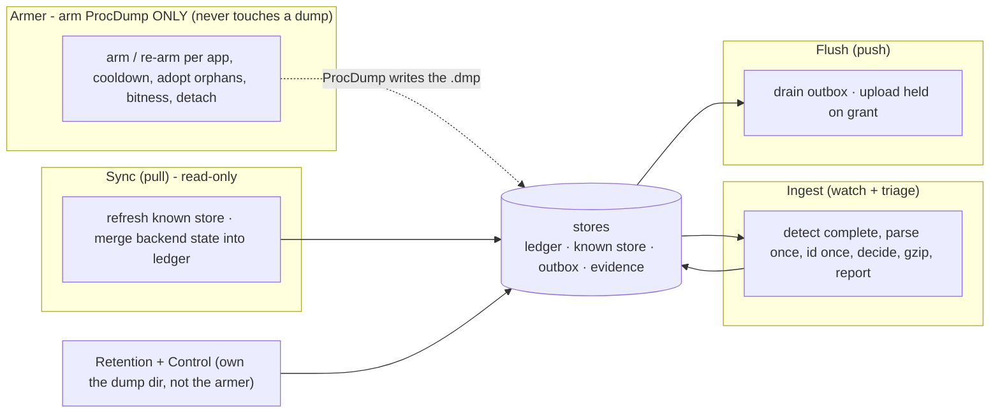

# 02 - Capabilities & concerns

## Capabilities

| Capability | Owned by |
|---|---|
| Keep failure capture armed on configured apps | Armer |
| Turn a raw dump into a deduplicated report + compressed evidence | Ingest |
| Remember, per machine, which signatures we already hold (offline-safe) | Ingest (writes the ledger) |
| Reconcile local memory with the backend's truth | Sync |
| Deliver reports + grant-authorized evidence to the backend | Flush |
| Bound local disk without losing un-delivered evidence | Retention |
| Hand evidence off manually when the link is unavailable | Control |

## The concerns - one job each

Each concern is a thin slice of the layers ([03](03-layers-and-dependency-rule.md)): a trigger -> a use
case -> domain + ports. They are **peers, not layers of each other**, and they communicate **only through
the stores** ([04](04-ports-and-contracts.md), [05](05-stores-and-data-model.md)) - never by calling one
another. That is what lets each run independently and lets offline work at all.

| Concern | Its one job | Owns (ports) | Never does |
|---|---|---|---|
| **Armer** | keep ProcDump armed per app: arm/re-arm on exit + cooldown, adopt orphans, bitness match, clean detach | CaptureControl | touch a dump file - no detect/read/rename/parse/triage/cleanup |
| **Ingest** | a landed dump -> report + deduped evidence: detect complete, parse once, id once, decide, gzip to final name, update ledger, write report | DumpReader, SignatureResolver, EvidenceCompressor, LedgerStore(write), Outbox(append), EvidenceStore(put) | any network |
| **Sync** (pull) | reconcile with the backend: refresh the known store, merge backend state into the ledger | KnownStore(refresh), LedgerStore(merge), BackendGateway(read), LinkProbe | push anything; write the backend |
| **Flush** (push) | deliver: drain the outbox, upload evidence under a grant | Outbox(drain), BackendGateway(write), LedgerStore(uploaded), EvidenceStore(free) | decide dedup; refresh refs |
| **Retention** | bound disk by the budget, evicting only safe (uploaded) evidence | EvidenceStore, LedgerStore(read) | evict held/granted/pending; arm anything |
| **Control** | user plane: enable/disable, test link, collect-for-manual, status | drives the use cases above | business policy of its own |

The armer only knows ProcDump processes (arm/exit/cooldown); the ingest watcher only knows the dump dir (a
new file appeared). The armer re-arms on ProcDump's own exit, never on a dump file - so it stays
responsive and dump-agnostic.
