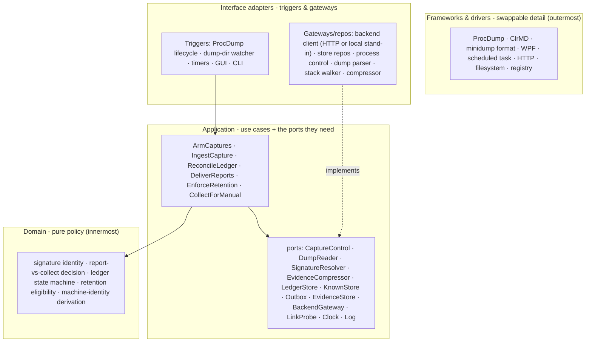

# 03 - Layers & dependency rule

Four layers, dependencies point **inward only**. Inner layers are pure policy; outer layers are swappable
detail. Nothing inner names anything outer - the outer side implements interfaces (**ports**,
[04](04-ports-and-contracts.md)) the inner side defines.

| Layer | Holds | Depends on |
|---|---|---|
| **Domain** (pure) | the signature concept, the report-vs-collect rules, the held/granted/uploaded state machine, retention-eligibility rules, deriving machine identity from a capture | nothing |
| **Application** (use cases + ports) | one use case per capability, and the port interfaces each needs | Domain only |
| **Interface adapters** | trigger surfaces (what wakes a use case) and gateway/repo implementations of the ports | Application |
| **Frameworks & drivers** | ProcDump, ClrMD, the minidump format, WPF, the scheduled-task host, HTTP, the filesystem, the registry | plug-ins |

**Dependency rule:** a trigger invokes a use case; the use case runs domain policy and calls ports it
owns; infrastructure implements those ports. Swapping the backend (HTTP vs local stand-in), the capture
tool, the UI, or the store medium never touches the domain or the use cases. If any such swap would force
a change inside a use case or the domain, the rule is being broken.
