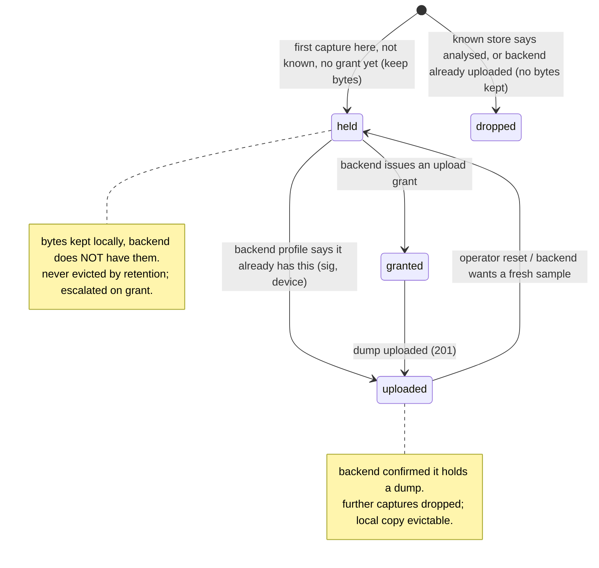

# 05 - Stores & data model

The stores are the single source of truth the concerns share ([04](04-ports-and-contracts.md)). There is
**one** local dedup ledger.

| Store | File | Owner | Role |
|---|---|---|---|
| Local ledger | `KnownIssues\device-ledger.json` | edge (authoritative local) | per-signature dedup state + count + kept-sample path |
| Known store (refs) | `KnownIssues\known-issues.baseline.json` | backend / update package | fleet-wide analysed signatures - read-only input, "ignore these" |
| Outbox | `KnownIssues\outbox\*.json` (+ `sent\`, `failed\`) | edge | durable per-capture reports awaiting send |
| Evidence | `DumpDir\*.dmp.gz` (+ `manual-outbox\`) | edge | kept, gzipped dump bytes |

`device-ledger.json` - one entry per signatureId:

```json
{ "<sig>": { "state": "held|granted|uploaded", "localCount": 3,
             "sample": "ProcDump_...dmp.gz", "firstSeenUtc": "...", "lastSeenUtc": "..." } }
```

- **state** - `held` (we have bytes, backend does not), `granted` (backend asked for it), `uploaded`
  (backend confirmed it has it).
- **localCount** - occurrences seen on this machine (the report carries it up).
- **sample** - the retained `.dmp.gz` for this signature, or null.

## Ledger state machine



`dropped` is not a stored state - it just means this capture kept no bytes; the next capture re-evaluates
against the known store + ledger (see the collect decision in [07](07-capability-flows.md)).

**Single source of truth:** dedup lives only in this ledger. No parallel registry, no second store that
can disagree. The backend profile is merged *into* it, never a competing copy.
