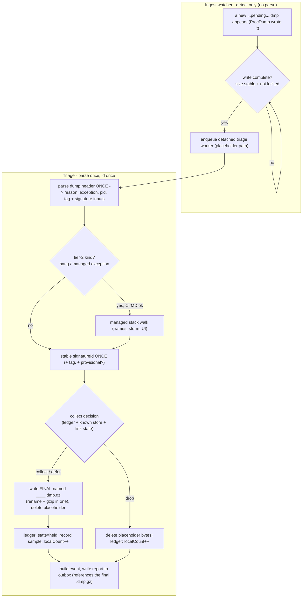
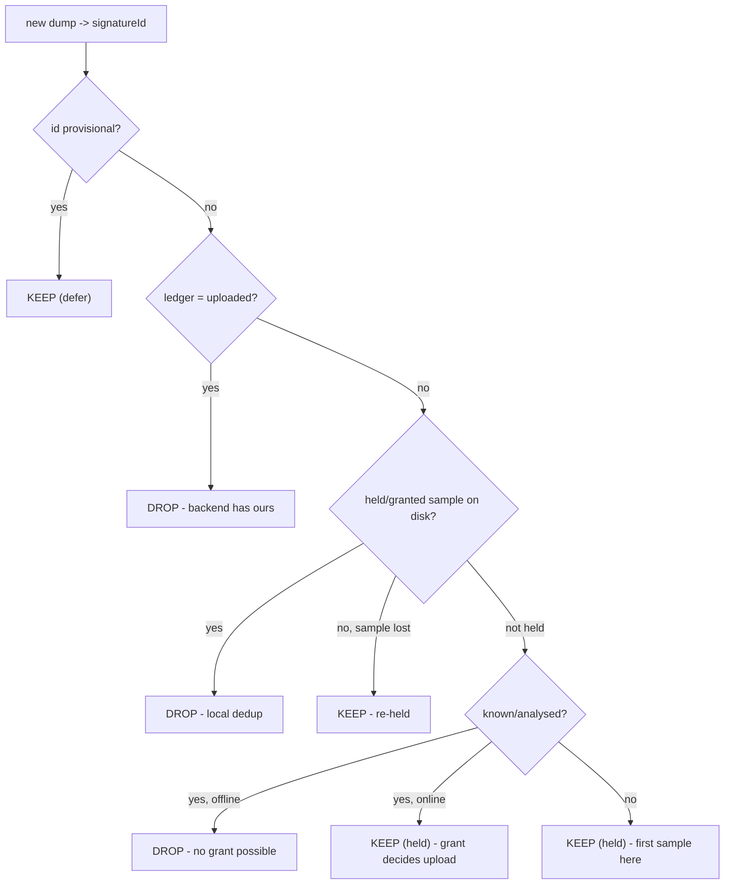
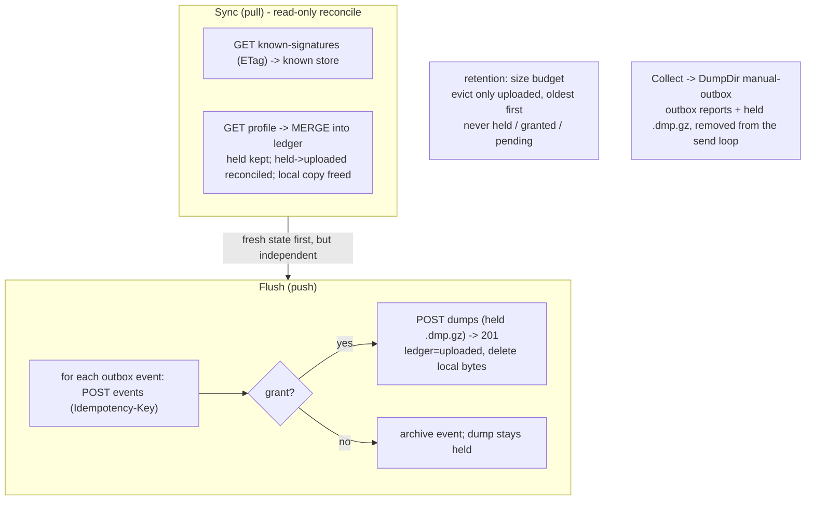
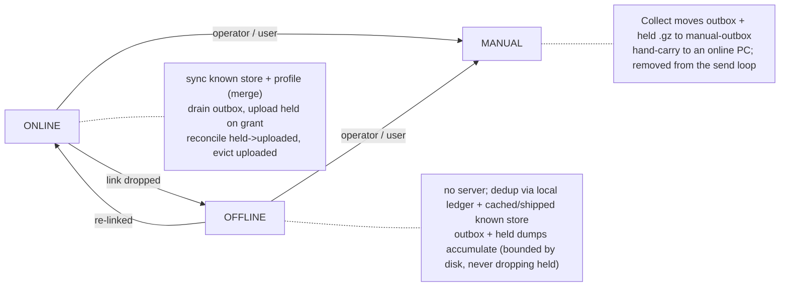

# 07 - Capability flows

How each capability moves through the layers, end to end.

## Ingest pipeline (dump lands -> report, no network)

The dump is parsed **exactly once** and the signatureId computed **exactly once**, in the detached triage
step (the hang/managed-exception id needs the slow ClrMD walk). Rename is folded into the gzip - the
final-named `.dmp.gz` is written straight from the placeholder - so the id is computed first, then the
file gets its final name, once. The report is written last, pointing at the final file.

## Collect decision (first match wins)

Two independent axes per capture. **Report** is unconditional - every capture emits one durable event and
bumps `localCount`. **Collect** decides only the dump *bytes*, top to bottom, first match wins:

| # | Condition | Bytes | Why |
|---|---|---|---|
| 1 | id **provisional** (managed walk pending) | KEEP (defer) | cannot dedup on an unreliable id |
| 2 | ledger = **uploaded** (this device already uploaded this id) | DROP | backend holds our sample |
| 3 | ledger **held/granted** and the sample is **on disk** | DROP | we already hold one - local dedup |
| 4 | ledger held/granted but the sample is **gone** (evicted/lost) | KEEP (re-held) | re-acquire a sample we lost |
| 5 | **known/analysed** and **offline** (no grant can come) | DROP | nothing can request it; do not hoard |
| 6 | **known/analysed** and **online** | KEEP (held) | the per-device grant is the authority; hold one |
| 7 | otherwise (new on this machine) | KEEP (held) | first sample here |

Offline duplicate-avoidance is rows 2-3: the ledger's `sample` is the "I already have one for this id"
memory, so repeated crashes of one signature while offline keep exactly ONE dump. Online, the grant stays
the sole upload authority (rows 5-6).

Every branch also emits the report; `DROP`/`KEEP` is only about the bytes.

## Sync (pull) and Flush (push) are separate

Staying in sync is not part of flushing - distinct jobs, failure modes, and cadence, each single-instance.

- **Sync (pull), read-only:** refresh the known store; merge the backend profile into the ledger (backend
  `uploaded`/`granted` overlaid on local `held`, never a blind overwrite). Writes only local stores. Useful
  on its own - keeps the collect decision correct even with an empty outbox - so it runs on its own cadence.
- **Flush (push):** per outbox event, deliver it; on a grant, upload the held `.dmp.gz` -> mark `uploaded`
  + free the local copy; no grant -> archive the event, the dump stays `held`.
- **When both run:** sync first (fresh state), but independent - a failed sync never stops a flush, and a
  sync runs when there is nothing to flush.

## Link lifecycle

