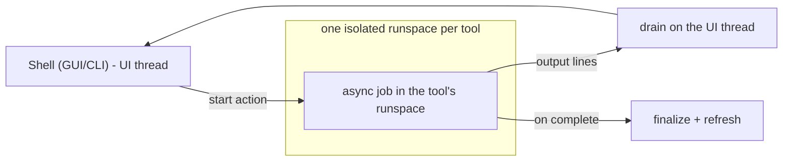

# 02 - Shell & tool hosting

The core's defining pattern: one control surface in two forms, and tools hosted off the UI thread behind a
uniform plugin contract.

## Two interchangeable shells

| Shell | When | Role |
|---|---|---|
| GUI (WPF window) | default, on an interactive desktop with WPF | the primary control surface |
| CLI (text menu) | `-CLI`, or automatic fallback where WPF is unavailable / fails to start | the guaranteed-available equivalent |

Both are **delivery adapters** over the same host operations (launch a tool, install a package, update).
Neither holds logic of its own; a failure to start the GUI falls back to the CLI without losing any
capability.

## The tool-hosting model

A tool action must never run on the UI thread. The host runs each tool in its **own isolated STA
runspace**:

- **One runspace per tool**, reused across that tool's actions, so colliding function names and long
  actions never clash or block the shell.
- Actions run **async**; their output is **drained on the UI thread** and streamed into the window/menu;
  a completion callback refreshes status. A failing refresh is contained - it never tears down the shell.
- A synchronous read path exists for populating editors (read a tool's config) when its runspace is idle.

## The tool plugin contract

Every hosted tool (Monitor, PerfView, Packages) obeys the same small contract, which is all the host
knows about it:

- **A standalone entry script** that also runs directly, outside the host.
- **Library-load mode:** when the host loads a tool into a runspace it sets a flag so the tool defines its
  functions without running its entry/elevation. A tool must honor that flag (expose functions, do not
  auto-run) when hosted.
- **Its own per-tool configuration and state** under its own machine-wide location - the host does not
  own a tool's config.
- **Dot-sources the shared platform** ([03](03-shared-platform.md)) for logging, the package store, and
  common helpers.

The host therefore launches and hosts any tool uniformly; a tool's internals (how the Monitor arms
capture, how PerfView collects a trace) are opaque to the host and documented in that tool's own library.

## Hosted tools (the registry)

| Tool | Kind | Architecture |
|---|---|---|
| Monitor | always-on background agent (crash/hang capture + telemetry) | [../monitor/](../monitor/README.md) |
| PerfView | on-demand ETW/ETL capture | (tool library, not yet written) |
| Packages | shared tool-binary install/verify surface | platform - see [03](03-shared-platform.md) |
