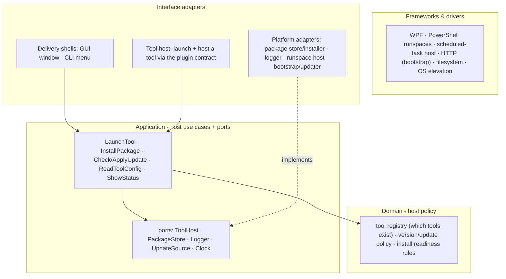

# 04 - Layers & dependency rule (host)

The host is small; it earns three boundaries - the delivery shell, the tool plugin boundary, and the
shared platform. Dependencies point inward.

| Layer | Holds | Depends on |
|---|---|---|
| **Domain** | the tool registry concept, version/update policy, install-readiness rules | nothing |
| **Application** | host use cases (launch a tool, install a package, check/apply an update, read a tool's config, show status) + the ports they need | Domain |
| **Interface adapters** | the GUI and CLI shells; the tool host; platform adapters (package store/installer, logger, runspace host, bootstrap/updater) | Application |
| **Frameworks & drivers** | WPF, PowerShell runspaces, the scheduled-task host, HTTP for bootstrap, the filesystem, OS elevation | plug-ins |

## The tool plugin boundary

A tool is a **plugin behind the `ToolHost` port**. The host launches and hosts a tool through the uniform
contract ([02](02-shell-and-tool-hosting.md)); it never names or depends on a tool's internals. This is
the key boundary:

- Adding or changing a tool (Monitor, PerfView, a future tool) never touches the host's use cases or domain.
- A tool runs in its own isolated runspace, so it cannot block the shell or collide with another tool.
- A tool's own subsystem architecture (its layers, its domain) lives in that tool's library - e.g. the
  Monitor's full backbone in [../monitor/](../monitor/README.md). Core stops at the plugin boundary.

**Dependency rule:** a shell or the tool host invokes a host use case; the use case runs host policy and
calls its ports; platform adapters implement those ports; tools plug in behind `ToolHost`. Swapping WPF
for the CLI, or the install source, never reaches the host's domain.
